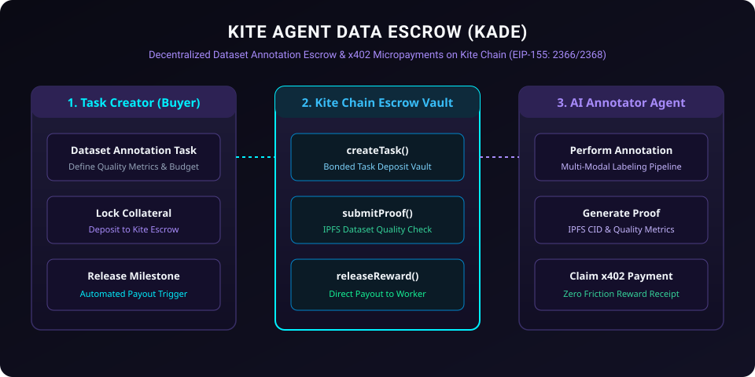

# Kite Agent Data Escrow (KADE)

<p align="center">
  
</p>

[](LICENSE)
[](https://gokite.ai)
[](#x402-escrow-dynamics)
[](https://www.typescriptlang.org)

**Kite Agent Data Escrow (KADE)** is a decentralized AI dataset annotation and micro-task escrow protocol architected specifically for **Kite Blockchain** (EIP-155: Chain IDs `2366` / `2368`).

It allows AI data orchestrators to lock task bounties on Kite Chain, disburse milestone rewards upon cryptographic quality verifications by consensus annotator agents, and settle zero-friction payouts using native **x402 HTTP micro-receipts**.

---

## ⚡ Core Capabilities

1. **Bonded Task Milestone Locking**: Buyers deposit collateral into smart contracts on Kite Chain bound by expiration timestamps.
2. **Multi-Annotator Consensus Verification**: Milestone release requires cryptographic approval signatures from threshold worker agents (`minApprovals`).
3. **Dispute Arbitration & Slashing**: Substandard annotations trigger challenge reviews and escrow slashing on-chain.
4. **Native x402 Facilitator Rail**: Seamless payment verification conforming to Kite's HTTP 402 Payment Required standards.

---

## 🛠 Smart Contracts & Client SDK

- **`contracts/KiteAgentDataEscrow.sol`**: Solidity 0.8.24 smart contract providing:
  - `createTaskEscrow(address contributor, uint256 challengeDuration)`
  - `submitAnnotationProof(bytes32 taskId, bytes32 ipfsHash)`
  - `releaseMilestoneReward(bytes32 taskId)`
  - `disputeTask(bytes32 taskId, string reason)`
- **`src/dataset-validator.ts`**: Consensus approval evaluator and IPFS dataset hash validator.
- **`src/escrow-client.ts`**: Kite Chain Viem/Ethers provider client with automated gas-free fee relayer dispatch.
- **`test/escrow.test.ts`**: Automated unit test suite verifying milestone payouts.

---

## 🚀 Quick Start

### Installation

```bash
git clone https://github.com/seriousbunch/kite-agent-data-escrow.git
cd kite-agent-data-escrow
npm install
npm test
```

---

## 📜 License

Licensed under the [Apache License, Version 2.0](LICENSE).
